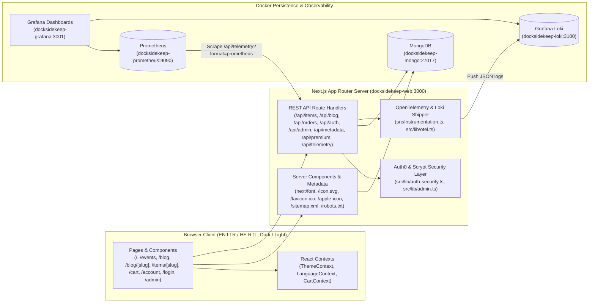
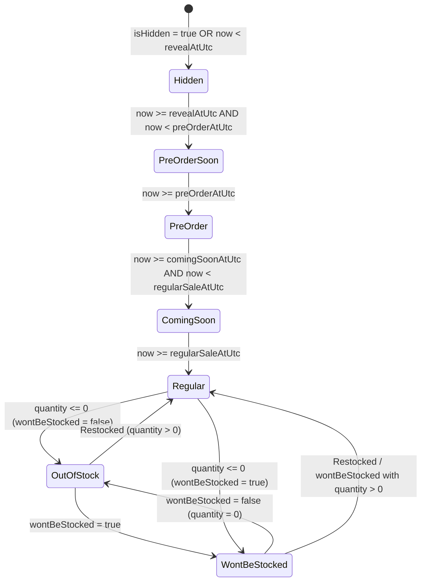
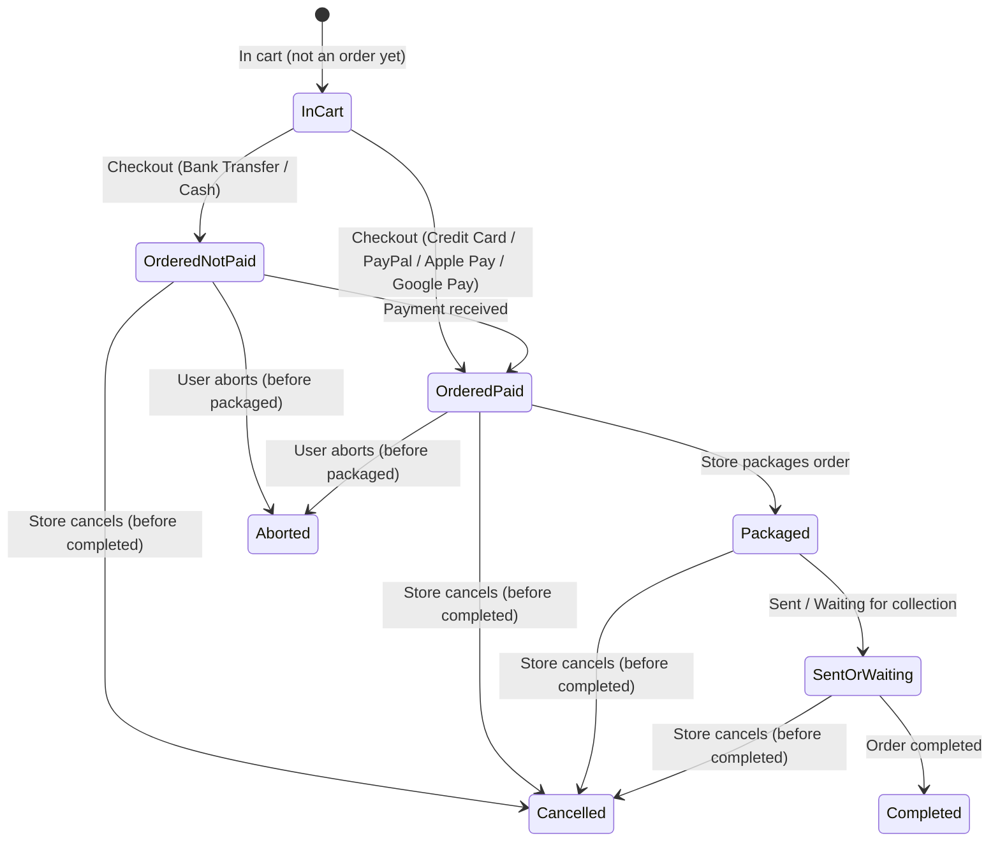
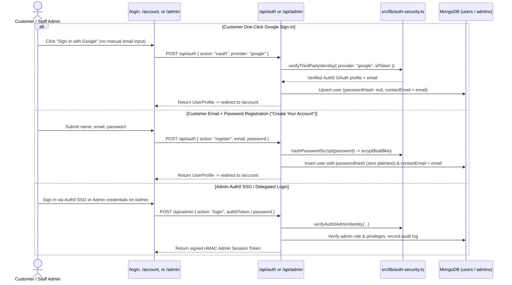

# Architecture & System Flows

This document explains the end-to-end architecture and core runtime flows of **Dockside Keep** (`docksidekeep-website`) for developers and AI agents.

---

## 1. High-Level System Architecture

---

## 2. Database-Level Filtering, Indexing & Collection Separation (`items` vs. `events`)

Store products and events live in two separate MongoDB collections (`items` and `events`). `src/lib/mongodb.ts` creates collection indexes on startup via `ensureDbIndexes(db)`, automatically migrates any legacy event documents out of `items` into `events`, and executes filtering, sorting, and pagination directly in MongoDB:

1. **Indexes Created (`ensureDbIndexes`)**:
   - `items`: `{ slug: 1 }` (unique), `{ inStock: 1, quantity: 1, createdAtUtc: -1 }`, `{ category: 1, createdAtUtc: -1 }`, `{ "money.price": 1 }`
   - `events`: `{ slug: 1 }` (unique), `{ inStock: 1, quantity: 1, createdAtUtc: -1 }`, `{ "money.price": 1 }`
   - `blog_posts`: `{ slug: 1 }` (unique), `{ createdAtUtc: -1 }`
   - `users`: `{ email: 1 }` (unique)
   - `admins`: `{ username: 1 }` (unique)
   - `orders`: `{ status: 1, expiresAtUtc: 1 }`
   - `order_ttl_holds`: `{ expiresAt: 1 }` (`expireAfterSeconds: 0` TTL index with `changeStreamPreAndPostImages` enabled)
2. **Store (`items`) vs. Events (`events`) Collection Separation**:
   - `getStoreProducts()` and `getPaginatedItems()` query the `items` collection.
   - `getEventTickets()` and `getPaginatedEvents()` query the `events` collection.
3. **Never Trust URL Query Parameters for Admin Authorization**:
   - API routes never check `?admin=1` on the URL. All admin-privileged reads and writes verify the logged-in entity via `resolveAdminSessionFromRequest(request, db)` in `src/lib/admin.ts`.

---

## 3. Store Item Lifecycle (`SaleStage`) & Order Lifecycle (`OrderLifecycleStatus`)

### 3.1 Store Item Lifecycle (`getItemSaleStage` in `src/lib/premium.ts`)

- **`hidden`** -> **`pre-order-soon`** -> **`pre-order`** -> **`coming-soon`** -> **`regular`** <-> **`out-of-stock`** <-> **`wont-be-stocked`**.
- An item marked `wontBeStocked: true` acts as **`regular`** while `quantity > 0` (`inStock !== false`) and transitions to **`wont-be-stocked`** once `quantity === 0`.

### 3.2 Order Lifecycle (`OrderLifecycleStatus` in `src/lib/premium.ts`)

- **Store Cancel (`cancelled`)**: At any point before `completed`, a logged-in store admin can cancel the order and automatically restore held stock to `items` / `events`.
- **User Abort (`aborted`)**: At any point before `packaged` (`ordered-not-paid` or `ordered-paid`), the logged-in customer who placed the order can abort it from `/account` and automatically restore held stock.

---

## 4. Customer & Admin Authentication Flow (Auth0 Delegation)

---

## 5. Checkout, Delivery & 3-Day Bank/Cash Reservation Flow

1. **Dedicated `/cart` Page**:
   - Displays cart items, loyalty discount breakdown, delivery method selector (`deliveryOptions` from `/api/metadata`), shipping address selector (from saved addresses or billing default), and payment method selector.
   - Gaming accounts (Wizards/Riot IDs) are managed exclusively on `/account` and never clutter `/cart`.
2. **Payment Method Branching (`POST /api/orders`)**:
   - **Credit Card / PayPal / Apple Pay / Google Pay**: Immediate fulfillment (`status: "ordered-paid"`), decrements `items.quantity` / `events.quantity`, increments `registeredCount` on event tickets, and awards loyalty points immediately.
   - **Bank Transfer / Cash (`bank-transfer` or `cash`)**: Creates a **3-day (72-hour) inventory reservation** (`status: "ordered-not-paid"`, `reservedUntilUtc = createdAtUtc + 72h`), immediately holds stock (`quantity` decremented), and inserts a companion TTL document into `order_ttl_holds` (`expiresAt: new Date(reservedUntilUtc)`).
   - **Capturing MongoDB TTL Deletion Events (`startOrderTtlChangeStream` & `handleOrderTtlDeletionEvent` in `src/lib/mongodb.ts`)**: Instead of polling or physically deleting order history, MongoDB's TTL index on `order_ttl_holds` (`expireAfterSeconds: 0`) deletes the hold document when `expiresAt` is reached. A Change Stream listener (`watch([{ $match: { operationType: "delete" } }], { fullDocumentBeforeChange: "whenAvailable" })`) captures the TTL `delete` event, transitions the corresponding order in `orders` from `ordered-not-paid` to `cancelled` (`cancelledReason: "ttl-expired-3-days"`), restores held stock to `items` and `events`, and increments the `dockside_order_ttl_deletions_total` OpenTelemetry/Prometheus metric.
